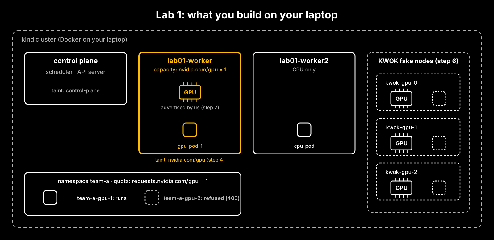

# Lab 1: Schedule a GPU workload on Kubernetes without a GPU

Your GPU pod is Pending. In this lab you find out what the scheduler actually checks, then make it schedule:
on a laptop cluster, with no GPU anywhere.



Runs on a laptop: Docker, kind and kubectl. No GPU, no cloud account. About 30 minutes if you build it yourself.

## Choose your path

| | **Path 1: Build it yourself** (recommended) | **Path 2: Run it all** |
|---|---|---|
| What you do | Write every manifest and run every command, step by step, with the *why* before each step | Run one script that does every step and saves the evidence |
| Good for | Learning it properly; preparing for the NCA-AIIO orchestration and scheduling topics | Seeing the whole picture fast, or checking your own run |
| Time | About 30 minutes | About 5 minutes |

Both paths use the same names, so `scripts/check.sh` checks either one. You can also mix them: build it yourself, and
look in `manifests/` whenever you get stuck.

## Before you start: four ideas in plain English

**Why fake a GPU?** Most people learning AI infrastructure don't have a GPU to practise on. The good news: the part
of Kubernetes that decides *where* a GPU workload runs, the scheduler, never touches a GPU. It reads a number on each
node, such as `nvidia.com/gpu: 1`, and does arithmetic. If we put that number on a node ourselves, the scheduler
makes its decisions exactly as it would on real hardware.

**What's an extended resource?** CPU and memory are built in. Anything else a node offers (a GPU, an FPGA, a licence
dongle) is an *extended resource*: a name and a whole number on the node. In a real cluster, NVIDIA's *device plugin*
finds the GPUs and advertises them as `nvidia.com/gpu`. In this lab, you're the device plugin.

**What's kind?** kind ("Kubernetes in Docker") runs a real Kubernetes cluster as Docker containers on your laptop.
Each container is a node. It's real Kubernetes, with the same scheduler and API, just small.

**What's KWOK?** KWOK ("Kubernetes WithOut Kubelet") adds *fake* nodes to a cluster. They look Ready to the
scheduler, but nothing runs on them: KWOK only simulates pod status. That lets you rehearse a fleet of GPU nodes on a
laptop. We use it in step 6.

## Install

| Tool | Version we used | Notes |
|---|---|---|
| Docker | Docker Desktop or Colima | kind runs nodes as containers. With Colima: `colima start` |
| kind | v0.33.0 | `brew install kind`, then `kind version` |
| kubectl | v1.37 | `brew install kubectl`, then `kubectl version --client` |
| KWOK | v0.8.0 | Installed into the cluster in step 6; nothing to install locally |

---

# Path 1: Build it yourself

Make a working folder so your files stay separate from ours:

```bash
mkdir -p ~/k8s-lab01 && cd ~/k8s-lab01
```

## Step 0: Create a laptop cluster

**Why:** we want three nodes with different jobs. The control plane runs Kubernetes itself. One worker will become our
"GPU node". The other stays a plain CPU node, so we can watch pods choose between them.

Create the cluster config:

```bash
cat > kind-cluster.yaml <<'EOF'
kind: Cluster
apiVersion: kind.x-k8s.io/v1alpha4
nodes:
- role: control-plane
  image: kindest/node:v1.37.0@sha256:a1ed56cfb0e7b93589bdf97c8cd566405a265939e3620fc4f5de89adff580ae5
- role: worker
  image: kindest/node:v1.37.0@sha256:a1ed56cfb0e7b93589bdf97c8cd566405a265939e3620fc4f5de89adff580ae5
- role: worker
  image: kindest/node:v1.37.0@sha256:a1ed56cfb0e7b93589bdf97c8cd566405a265939e3620fc4f5de89adff580ae5
EOF
```

The long `sha256` pins the exact node image, so you get the same Kubernetes (v1.37.0) we tested with.

```bash
kind create cluster --name lab01 --config kind-cluster.yaml
kubectl get nodes
```

**What you should see:** three nodes, all `Ready`, all `v1.37.0`: `lab01-control-plane`, `lab01-worker` and
`lab01-worker2`.

## Step 1: Break it. Ask for a GPU that doesn't exist

**Why:** before fixing anything, we want to see exactly how Kubernetes says "no". Reading the scheduler's reason is
the most useful debugging skill in this lab.

Write a pod that asks for one GPU:

```bash
cat > gpu-pod-1.yaml <<'EOF'
apiVersion: v1
kind: Pod
metadata:
  name: gpu-pod-1
spec:
  containers:
  - name: app
    image: busybox:1.36.1
    command: ["sh", "-c", "echo 'pretending to train'; sleep 3600"]
    resources:
      limits:
        nvidia.com/gpu: 1
  tolerations:
  - key: nvidia.com/gpu
    operator: Exists
    effect: NoSchedule
EOF
kubectl apply -f gpu-pod-1.yaml
kubectl get pods
```

Two things to notice in what you just wrote:
- **The GPU is under `limits`.** That's the rule for GPUs: you set a limit, and Kubernetes uses it as the request too.
  If you set both, they must be equal. A request without a limit isn't allowed.
- **The `tolerations` block** does nothing yet. It matters in step 4; we add it now so we don't have to recreate the pod.

The pod stays `Pending`. Ask why:

```bash
kubectl describe pod gpu-pod-1
```

**What you should see** at the bottom (from our run):

```
Warning  FailedScheduling  default-scheduler  0/3 nodes are available: 1 node(s) had untolerated taint(s),
2 Insufficient nvidia.com/gpu. preemption: 0/3 nodes are available: 3 Preemption is not helpful for scheduling.
```

**What just happened:** the scheduler checked all three nodes and *filtered* every one out:
- **The control plane** has a taint that keeps ordinary workloads off it ("untolerated taint").
- **The two workers** have no `nvidia.com/gpu` at all ("Insufficient nvidia.com/gpu").
- **Preemption** (evicting lower-priority pods to make room) can't help, because no node has a GPU to free up.

Also look higher up in the `describe` output: under the container you'll see `Requests: nvidia.com/gpu: 1`, even
though you only wrote a limit. Kubernetes filled it in.

## Step 2: Fix it. Advertise a GPU on a node

**Why:** in a real cluster, the NVIDIA device plugin would tell Kubernetes "this node has one GPU". We'll send the same
message ourselves. Kubernetes doesn't check that the GPU exists; it only records the number.

The message is a PATCH to the node's status. Open a **second terminal** and start a local proxy to the API server:

```bash
kubectl proxy
```

Back in your **first terminal**, send the PATCH:

```bash
curl --header "Content-Type: application/json-patch+json" \
  --request PATCH \
  --data '[{"op": "add", "path": "/status/capacity/nvidia.com~1gpu", "value": "1"}]' \
  http://localhost:8001/api/v1/nodes/lab01-worker/status
```

The odd-looking `~1` is how JSON Patch writes a `/` inside a name, so the path means `capacity/nvidia.com/gpu`.
Stop the proxy (Ctrl+C in the second terminal) when you're done. Our `scripts/advertise-gpu.sh` does exactly these
steps for you.

Check the node and the pod:

```bash
kubectl get node lab01-worker -o jsonpath='{.status.capacity}'; echo
kubectl get pods -o wide
```

**What you should see** (from our run):

```
{"cpu":"4", ... "memory":"3999212Ki","nvidia.com/gpu":"1","pods":"110"}

NAME        READY   STATUS    RESTARTS   AGE   IP           NODE
gpu-pod-1   1/1     Running   0          25s   10.244.1.2   lab01-worker
```

Your CPU and memory figures depend on how much you give Docker; the `nvidia.com/gpu` entry is the one that matters.

**What just happened:** `gpu-pod-1` went from Pending to Running on `lab01-worker`, without you touching the pod. The
scheduler kept retrying, and as soon as a node could fit it, it placed it.

See the GPU being used:

```bash
kubectl describe node lab01-worker | grep -A 12 "Allocated resources"
```

You should find `nvidia.com/gpu  1  1` at the bottom: one GPU requested out of one advertised.

## Step 3: One GPU, one pod

**Why:** a GPU isn't like CPU, which can be split into fractions (`500m`). Extended resources are whole numbers and
can't be overcommitted. Let's prove it with a second pod.

```bash
sed 's/gpu-pod-1/gpu-pod-2/' gpu-pod-1.yaml > gpu-pod-2.yaml
kubectl apply -f gpu-pod-2.yaml
kubectl describe pod gpu-pod-2 | tail -3
```

**What you should see** (from our run):

```
0/3 nodes are available: 1 node(s) had untolerated taint(s), 2 Insufficient nvidia.com/gpu.
preemption: 0/3 nodes are available: 1 No preemption victims found for incoming pod, 2 Preemption is not helpful for scheduling.
```

**What just happened:** the GPU node's one GPU is in use, so it's "Insufficient" too. Note the new phrase: "No
preemption victims found". The scheduler did consider evicting a pod from that node, but none has a lower priority,
so it won't. Sharing one GPU between pods needs other tools (time-slicing, MIG, DRA, HAMi): that's Lab 2.

## Step 4: Keep other pods off the GPU node

**Why:** GPU nodes are expensive. If ordinary pods (web servers, cron jobs) fill them up, your training jobs can't run.
A **taint** on a node repels every pod that doesn't carry a matching **toleration**.

Taint the GPU node:

```bash
kubectl taint nodes lab01-worker nvidia.com/gpu=present:NoSchedule
```

Write a pod that needs no GPU and has no toleration:

```bash
cat > cpu-pod.yaml <<'EOF'
apiVersion: v1
kind: Pod
metadata:
  name: cpu-pod
spec:
  containers:
  - name: app
    image: busybox:1.36.1
    command: ["sh", "-c", "echo 'web traffic'; sleep 3600"]
    resources:
      requests:
        cpu: 50m
        memory: 32Mi
EOF
kubectl apply -f cpu-pod.yaml
kubectl get pods -o wide
```

**What you should see** (from our run, columns trimmed):

```
NAME        READY   STATUS    NODE
cpu-pod     1/1     Running   lab01-worker2
gpu-pod-1   1/1     Running   lab01-worker
gpu-pod-2   0/1     Pending   <none>
```

**What just happened:** `cpu-pod` can't tolerate the new taint, so it lands on `lab01-worker2`. Your GPU pods carry the
toleration you wrote in step 1, so they're still allowed on the GPU node. Kubernetes can add these tolerations for you
(the `ExtendedResourceToleration` admission controller), but it's off by default, which is why we wrote them by hand.

**Try this:** taint a node yourself, then remove the taint. The trailing `-` removes it:

```bash
kubectl taint nodes lab01-worker2 demo=true:NoSchedule
kubectl taint nodes lab01-worker2 demo=true:NoSchedule-
```

## Step 5: Cap a team at one GPU

**Why:** in a shared cluster, one team shouldn't be able to grab every GPU. A **ResourceQuota** sets a hard limit per
namespace. For GPUs the quota key starts with `requests.`, because GPU requests always equal limits.

Free the GPU first, then create the team's namespace and quota:

```bash
kubectl delete pod gpu-pod-1 gpu-pod-2

cat > team-quota.yaml <<'EOF'
apiVersion: v1
kind: Namespace
metadata:
  name: team-a
---
apiVersion: v1
kind: ResourceQuota
metadata:
  name: gpu-quota
  namespace: team-a
spec:
  hard:
    requests.nvidia.com/gpu: "1"
EOF
kubectl apply -f team-quota.yaml
```

Now write two GPU pods for team-a. They're the same as `gpu-pod-1`, with a new name and a namespace:

```bash
for n in 1 2; do
cat > team-a-gpu-$n.yaml <<EOF
apiVersion: v1
kind: Pod
metadata:
  name: team-a-gpu-$n
  namespace: team-a
spec:
  containers:
  - name: app
    image: busybox:1.36.1
    command: ["sh", "-c", "sleep 3600"]
    resources:
      limits:
        nvidia.com/gpu: 1
  tolerations:
  - key: nvidia.com/gpu
    operator: Exists
    effect: NoSchedule
EOF
done
kubectl apply -f team-a-gpu-1.yaml
kubectl apply -f team-a-gpu-2.yaml
```

**What you should see** (from our run). The first is created; the second is refused:

```
Error from server (Forbidden): error when creating "team-a-gpu-2.yaml": pods "team-a-gpu-2" is forbidden: exceeded
quota: gpu-quota, requested: requests.nvidia.com/gpu=1, used: requests.nvidia.com/gpu=1, limited: requests.nvidia.com/gpu=1
```

**What just happened:** this is a different "no" from step 3:

| | Step 3: no node fits | Step 5: quota exceeded |
|---|---|---|
| Who says no | The scheduler | The API server, before the pod exists |
| What you get | A pod that *waits* (Pending) | An error; *no pod is created* (403 Forbidden) |
| Fix | Add capacity | Raise the quota, or free GPUs in that namespace |

```bash
kubectl describe resourcequota gpu-quota -n team-a
```

shows `requests.nvidia.com/gpu  1  1`: one used out of one allowed.

## Step 6: Rehearse a GPU fleet with KWOK

**Why:** you can't fit eight GPU servers on a laptop, but you can fit eight *fake* nodes. KWOK keeps them Ready and
simulates pods on them, so you can see how the scheduler spreads GPU work across a fleet.

Install KWOK into the cluster: first its controller, then its "stages", the rules that decide how fake pods behave
(here: become Running quickly).

```bash
kubectl apply -f https://github.com/kubernetes-sigs/kwok/releases/download/v0.8.0/kwok.yaml
kubectl apply -f https://github.com/kubernetes-sigs/kwok/releases/download/v0.8.0/stage-fast.yaml
kubectl -n kube-system rollout status deployment/kwok-controller
```

Create three fake GPU nodes. A node is just an API object, so you write it like any other manifest:

```bash
for i in 0 1 2; do
cat <<EOF | kubectl apply -f -
apiVersion: v1
kind: Node
metadata:
  name: kwok-gpu-$i
  annotations:
    node.alpha.kubernetes.io/ttl: "0"
    kwok.x-k8s.io/node: fake
  labels:
    kubernetes.io/hostname: kwok-gpu-$i
    kubernetes.io/os: linux
    kubernetes.io/arch: amd64
    type: kwok
spec:
  taints:
  - effect: NoSchedule
    key: kwok.x-k8s.io/node
    value: fake
status:
  allocatable: {cpu: "32", memory: 256Gi, pods: "110", nvidia.com/gpu: "1"}
  capacity: {cpu: "32", memory: 256Gi, pods: "110", nvidia.com/gpu: "1"}
EOF
done
kubectl get nodes
```

What each part does:
- **The annotation** `kwok.x-k8s.io/node: fake` tells KWOK "this node is yours to simulate".
- **The taint** keeps real workloads off fake nodes, where they could never actually run.
- **`status`** is where the GPU is advertised: the same field you patched by hand in step 2.

`kubectl get nodes` now lists `kwok-gpu-0`, `kwok-gpu-1` and `kwok-gpu-2` as `Ready`, with version `kwok-v0.8.0`.

Now a Deployment of three GPU workers that tolerate both taints:

```bash
cat > trainer.yaml <<'EOF'
apiVersion: apps/v1
kind: Deployment
metadata:
  name: trainer
spec:
  replicas: 3
  selector:
    matchLabels: {app: trainer}
  template:
    metadata:
      labels: {app: trainer}
    spec:
      containers:
      - name: app
        image: busybox:1.36.1
        command: ["sh", "-c", "sleep 3600"]
        resources:
          limits:
            nvidia.com/gpu: 1
      tolerations:
      - {key: nvidia.com/gpu, operator: Exists, effect: NoSchedule}
      - {key: kwok.x-k8s.io/node, operator: Exists, effect: NoSchedule}
EOF
kubectl apply -f trainer.yaml
kubectl get pods -l app=trainer -o wide
```

**What you should see:** three `trainer` pods, `Running`, one on each of `kwok-gpu-0`, `kwok-gpu-1` and `kwok-gpu-2`
(in our run they landed on kwok-gpu-2, kwok-gpu-0 and kwok-gpu-1).

**What just happened:** the real GPU node's only GPU is taken by `team-a-gpu-1`, so each replica goes to a fake node
with a free GPU, one per node. KWOK reports them Running; no container actually started.

**Try this:** scale to four replicas with `kubectl scale deployment trainer --replicas=4`. Where does the fourth one
go, and what does `kubectl describe pod` say about it? You've seen this message before.

## Check your work

From this lab's folder in the repo:

```bash
scripts/check.sh
```

Our run: `7 passed, 0 failed`. When you're done, delete the cluster: `kind delete cluster --name lab01`.

---

# Path 2: Run it all

```bash
cd lab01-gpu-scheduling
scripts/run-lab.sh      # every step; evidence saved to runs/<date-time>/
scripts/check.sh        # 7 checks
scripts/cleanup.sh      # delete the cluster
```

The manifests it uses are in `manifests/`, numbered by step. Read `runs/<date-time>/steps.log` afterwards and compare
it with the "What you should see" blocks in Path 1.

---

## What this lab does not show

- **No real GPU, driver or device plugin.** The number on the node is ours, not the hardware's.
- **Pods on KWOK nodes don't really run.** KWOK only simulates their status.
- **GPU sharing** (time-slicing, MPS, MIG, DRA, HAMi) is Lab 2.

## Tested

| Date | Machine | Versions | Result |
|---|---|---|---|
| 17 October 2026 | Apple silicon Mac (arm64), 16 GB, macOS 27.0.1 | Docker 29.7.2 client / 29.5.2 server, kind v0.33.0, kubectl v1.37.1, Kubernetes v1.37.0, KWOK v0.8.0 | `run-lab.sh` completed; `check.sh` 7 passed, 0 failed |

## Runs

Measured on 17 October 2026 with `run-lab.sh`:
- **Steps 1 and 3:** both GPU pods were filtered off all 3 nodes; the `FailedScheduling` messages are quoted above.
- **Step 2:** `lab01-worker` went from no GPU in its capacity to `"nvidia.com/gpu":"1"`, and `gpu-pod-1` was Running there (pod age 25 s when checked).
- **Persistence:** 60 seconds after the last step, the hand-advertised GPU was still in the node's capacity.
- **Step 5:** the second team-a pod was refused: `exceeded quota: gpu-quota … limited: requests.nvidia.com/gpu=1`.
- **Step 6:** 3 fake GPU nodes were Ready (version `kwok-v0.8.0`), and the 3 `trainer` replicas landed one per fake node.

Independent course. Not affiliated with or endorsed by NVIDIA.
