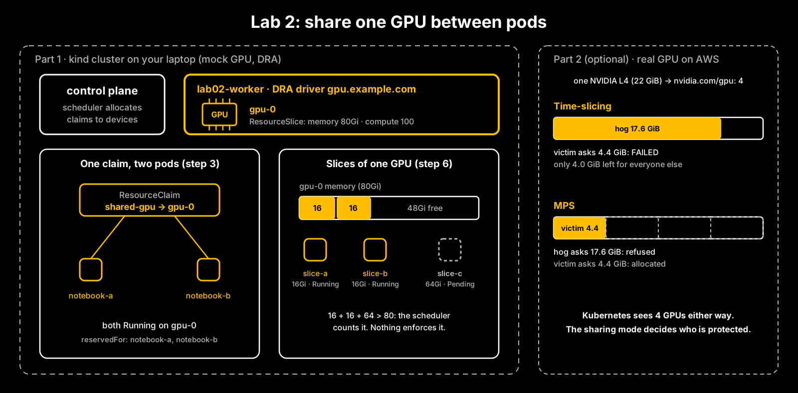

# Lab 2: Share one GPU between pods with DRA

In Lab 1 a GPU was a whole number: one GPU, one pod. In this lab you share one GPU between pods, first on a
laptop with Kubernetes' Dynamic Resource Allocation (DRA), then (optional) on a real NVIDIA GPU, where you find
out what sharing does and doesn't protect.



**Part 1** runs on a laptop: Docker, kind, kubectl and Helm. No GPU, no cloud account. About 30 minutes if you
build it yourself.
**Part 2 (optional, GPU)** runs on one small GPU instance in AWS for about 10 minutes. It needs an AWS account
and costs money while it runs: see [Part 2](#part-2-optional-gpu-on-aws-time-slicing-vs-mps).

## Choose your path (Part 1)

| | **Path 1: Build it yourself** (recommended) | **Path 2: Run it all** |
|---|---|---|
| What you do | Write every manifest and run every command, step by step, with the *why* before each step | Run one script that does every step and saves the evidence |
| Good for | Learning it properly; preparing for the NCA-AIIO orchestration and GPU topics | Seeing the whole picture fast, or checking your own run |
| Time | About 30 minutes | About 5 minutes |

Both paths use the same names, so `scripts/check.sh` checks either one. The finished manifests are in `manifests/`.

## Before you start: four ideas in plain English

**Why DRA?** In Lab 1 a GPU was an *extended resource*: a name and a whole number on the node (`nvidia.com/gpu: 1`).
That model can't say "these two pods share this one GPU" or "give me 16Gi of it". Dynamic Resource Allocation is
Kubernetes' newer way to hand out devices. It is stable since Kubernetes v1.35.

**The DRA objects.** A driver on each node publishes its devices in a **ResourceSlice**. A **DeviceClass** names a
kind of device (here `gpu.example.com`). A pod asks for a device through a **ResourceClaim**. A
**ResourceClaimTemplate** stamps out a new claim for each pod. The scheduler picks a device that fits the claim
and a node that has it.

**What's the mock driver?** We use the Kubernetes project's own example DRA driver, `dra-example-driver`. It
advertises mock GPUs (80Gi of memory, 100 units of compute each). **No container gets a real GPU.** Instead the
driver writes environment variables into the container saying which GPU it *would* have given it, and how it
would have been shared. Every pod in this lab prints those variables, so you can see each decision.

**Sharing, two ways.** Several pods can use *one claim*: they all get the same device. Or the device can allow
*several claims*, each taking a slice of its capacity. You'll do both.

## Install

| Tool | Version we used | Notes |
|---|---|---|
| Docker | Colima (Docker 29.5) | kind runs nodes as containers. With Colima: `colima start --cpu 4 --memory 8` |
| kind | v0.33.0 | `brew install kind` |
| kubectl | v1.37 | `brew install kubectl` |
| Helm | v3.18 | `brew install helm`. Installs the mock driver in step 1 |

---

# Part 1: Build it yourself

Make a working folder so your files stay separate from ours:

```bash
mkdir -p ~/k8s-lab02 && cd ~/k8s-lab02
```

## Step 0: Create a laptop cluster

**Why:** one worker is enough: it will hold our one mock GPU. Two settings matter. **CDI** (the Container Device
Interface) is how DRA drivers hand devices to containers, so we switch it on in containerd. And we turn on two
DRA feature gates that steps 5 and 6 use.

```bash
cat > kind-cluster.yaml <<'EOF'
kind: Cluster
apiVersion: kind.x-k8s.io/v1alpha4
featureGates:
  DRAExtendedResource: true
  DRAConsumableCapacity: true
containerdConfigPatches:
- |-
  [plugins."io.containerd.grpc.v1.cri"]
    enable_cdi = true
nodes:
- role: control-plane
  image: kindest/node:v1.37.0@sha256:a1ed56cfb0e7b93589bdf97c8cd566405a265939e3620fc4f5de89adff580ae5
- role: worker
  image: kindest/node:v1.37.0@sha256:a1ed56cfb0e7b93589bdf97c8cd566405a265939e3620fc4f5de89adff580ae5
EOF
kind create cluster --name lab02 --config kind-cluster.yaml
kubectl api-resources --api-group=resource.k8s.io
```

**What you should see** (from our run):

```
NAME                     SHORTNAMES   APIVERSION           NAMESPACED   KIND
deviceclasses                         resource.k8s.io/v1   false        DeviceClass
devicetaintrules                      resource.k8s.io/v1   false        DeviceTaintRule
resourceclaims                        resource.k8s.io/v1   true         ResourceClaim
resourceclaimtemplates                resource.k8s.io/v1   true         ResourceClaimTemplate
resourceslices                        resource.k8s.io/v1   false        ResourceSlice
```

These are the DRA objects from "Before you start", served at `resource.k8s.io/v1`.

## Step 1: Install the mock-GPU driver

**Why:** DRA needs a driver on the node to publish devices. We install the example driver with Helm and ask it for
**one** GPU, so every step below fights over the same device.

```bash
helm upgrade -i dra-example-driver oci://registry.k8s.io/dra-example-driver/charts/dra-example-driver \
  --version 0.5.0 --namespace dra-example-driver --create-namespace \
  --set kubeletPlugin.numDevices=1 --wait --timeout 15m
kubectl get deviceclass
kubectl get resourceslices -o yaml
```

The driver's image is about 60 MB. On a slow connection the first download can take several minutes (one of our
runs needed nearly 10), which is why we give Helm 15.

**What you should see** (from our run, trimmed): a DeviceClass `gpu.example.com`, and one ResourceSlice from
`lab02-worker` with one device:

```yaml
    devices:
    - allowMultipleAllocations: false
      attributes:
        model:
          string: LATEST-GPU-MODEL
      capacity:
        compute:
          value: "100"
        memory:
          value: 80Gi
      name: gpu-0
    driver: gpu.example.com
    nodeName: lab02-worker
```

**What just happened:** in Lab 1 *you* wrote the GPU onto the node. Here the driver publishes it, with
attributes (model) and capacity (memory, compute) that claims can ask for. `allowMultipleAllocations: false`
means one claim at a time. Remember it for step 6.

## Step 2: Break it. A claim each, one GPU

**Why:** before sharing, see the wall. Two pods, each with its own claim (a template stamps one per pod).

First the claim template, then one pod file you'll reuse in every step. `POD_NAME` and `CLAIM_REF` are
placeholders that `sed` fills in:

```bash
cat > one-gpu.yaml <<'EOF'
apiVersion: resource.k8s.io/v1
kind: ResourceClaimTemplate
metadata:
  name: one-gpu
spec:
  spec:
    devices:
      requests:
      - name: gpu
        exactly:
          deviceClassName: gpu.example.com
EOF
cat > pod.yaml <<'EOF'
apiVersion: v1
kind: Pod
metadata:
  name: POD_NAME
spec:
  containers:
  - name: app
    image: busybox:1.36.1
    command: ["sh", "-c", "env | grep GPU_DEVICE | sort; sleep 3600"]
    resources:
      claims:
      - name: gpu
  resourceClaims:
  - name: gpu
    CLAIM_REF
EOF
kubectl apply -f one-gpu.yaml
for p in trainer-a trainer-b; do
  sed "s/POD_NAME/$p/; s/CLAIM_REF/resourceClaimTemplateName: one-gpu/" pod.yaml | kubectl apply -f -
done
kubectl get pods
kubectl get resourceclaims
kubectl logs trainer-a
kubectl describe pod trainer-b | tail -3
```

Note the shape: the container lists `resources.claims`, and the pod's `resourceClaims` says where the claim comes
from (here, the template).

**What you should see** (from our run):

```
trainer-a   1/1     Running   ...
trainer-b   0/1     Pending   ...

NAME                  STATE                AGE
trainer-a-gpu-sd8v6   allocated,reserved   16s
trainer-b-gpu-52t5c   pending              16s

GPU_DEVICE_0=gpu-0
GPU_DEVICE_0_SHARING_STRATEGY=TimeSlicing
GPU_DEVICE_0_TIMESLICE_INTERVAL=Default

Warning  FailedScheduling  default-scheduler  0/2 nodes are available: 1 cannot allocate all claims,
1 node(s) had untolerated taint(s). preemption: 0/2 nodes are available: 2 Preemption is not helpful for scheduling.
```

**What just happened:** each pod got its own claim. `trainer-a`'s claim was allocated `gpu-0`; `trainer-b`'s claim
has nothing left to allocate, so the scheduler says "cannot allocate all claims". Same wall as Lab 1, new words.

Clean up before the next step: `kubectl delete pod trainer-a trainer-b; kubectl delete -f one-gpu.yaml`

## Step 3: Share it. Two pods, one claim

**Why:** if two pods point at *the same* ResourceClaim, they get the same device. Instead of a template, we create
one named claim and reference it by name.

```bash
cat > shared-claim.yaml <<'EOF'
apiVersion: resource.k8s.io/v1
kind: ResourceClaim
metadata:
  name: shared-gpu
spec:
  devices:
    requests:
    - name: gpu
      exactly:
        deviceClassName: gpu.example.com
EOF
kubectl apply -f shared-claim.yaml
for p in notebook-a notebook-b; do
  sed "s/POD_NAME/$p/; s/CLAIM_REF/resourceClaimName: shared-gpu/" pod.yaml | kubectl apply -f -
done
kubectl get pods
kubectl logs notebook-a; kubectl logs notebook-b
kubectl get resourceclaim shared-gpu -o jsonpath='{.status.reservedFor}'; echo
```

**What you should see** (from our run): both `Running`, both on `gpu-0`, with the same claim ID, and the claim
reserved for both pods:

```
notebook-a   1/1     Running   ...
notebook-b   1/1     Running   ...

GPU_DEVICE_0=gpu-0
GPU_DEVICE_0_SHARING_STRATEGY=TimeSlicing
GPU_DEVICE_GPU_0_RESOURCE_CLAIM=9ef527cf-cf6f-4541-a0df-a8e1b120cf51   (the same in both pods)

[{"name":"notebook-a","resource":"pods",...},{"name":"notebook-b","resource":"pods",...}]
```

**What just happened:** one claim, one device, two consumers. Kubernetes counted one GPU, allocated once, and
recorded both pods in `reservedFor`. Whether the two pods can actually run on that GPU at the same time is up to
the driver. This one reports `TimeSlicing`: they would take turns.

Clean up: `kubectl delete pod notebook-a notebook-b; kubectl delete -f shared-claim.yaml`

## Step 4: Say how to share

**Why:** a claim can carry settings for the driver ("opaque" config: Kubernetes passes it on without reading it).
The example driver understands a `GpuConfig`; we ask for long time slices.

```bash
cat > sharing-setting.yaml <<'EOF'
apiVersion: resource.k8s.io/v1
kind: ResourceClaim
metadata:
  name: shared-gpu-long
spec:
  devices:
    requests:
    - name: gpu
      exactly:
        deviceClassName: gpu.example.com
    config:
    - requests: ["gpu"]
      opaque:
        driver: gpu.example.com
        parameters:
          apiVersion: gpu.resource.example.com/v1alpha1
          kind: GpuConfig
          sharing:
            strategy: TimeSlicing
            timeSlicingConfig:
              interval: Long
EOF
kubectl apply -f sharing-setting.yaml
sed "s/POD_NAME/notebook-c/; s/CLAIM_REF/resourceClaimName: shared-gpu-long/" pod.yaml | kubectl apply -f -
kubectl logs notebook-c
```

**What you should see** (from our run): `GPU_DEVICE_0_TIMESLICE_INTERVAL=Long` instead of `Default`.

**What just happened:** the setting travelled from the claim to the driver, which "configured" the GPU. With a real
driver this is where you'd choose time-slicing or a partitioning mode, and its settings, per claim, not per node.

Clean up: `kubectl delete pod notebook-c; kubectl delete -f sharing-setting.yaml`

## Step 5: The Lab 1 way, served by DRA

**Why:** most existing workloads ask for GPUs with `resources.limits`, as in Lab 1. With the `DRAExtendedResource`
feature, a DRA device class can answer that kind of request too, so old manifests keep working.

```bash
cat > classic-pod.yaml <<'EOF'
apiVersion: v1
kind: Pod
metadata:
  name: classic-pod
spec:
  containers:
  - name: app
    image: busybox:1.36.1
    command: ["sh", "-c", "env | grep GPU_DEVICE | sort; sleep 3600"]
    resources:
      limits:
        deviceclass.resource.kubernetes.io/gpu.example.com: 1
EOF
kubectl apply -f classic-pod.yaml
kubectl get resourceclaims
kubectl logs classic-pod
```

**What you should see** (from our run): the pod `Running`, and a claim you didn't write:

```
NAME                                   STATE                AGE
classic-pod-extended-resources-gjtcf   allocated,reserved   0s

GPU_DEVICE_0=gpu-0
```

**What just happened:** Kubernetes turned the limit into a ResourceClaim for you. Same request style as Lab 1; DRA
underneath.

Clean up: `kubectl delete -f classic-pod.yaml`

## Step 6: Slice it

**Why:** sharing one claim means sharing *everything*. The other way is to let several claims each take a
**slice** of one device's capacity (the `DRAConsumableCapacity` feature). We reinstall the driver with that
switched on, then ask for 16Gi, 16Gi and 64Gi of the GPU's 80Gi.

```bash
helm upgrade -i dra-example-driver oci://registry.k8s.io/dra-example-driver/charts/dra-example-driver \
  --version 0.5.0 --namespace dra-example-driver \
  --set kubeletPlugin.numDevices=1 --set gpuAllowMultipleAllocations=true --wait --timeout 15m
kubectl get resourceslices -o jsonpath='{.items[*].spec.devices[*].allowMultipleAllocations}'; echo
```

It should print `true`. Now three claims, each with a pod (`slice-b` is the same as `slice-a`; `slice-c` asks for
64Gi):

```bash
for s in slice-a:16Gi slice-b:16Gi slice-c:64Gi; do n=${s%%:*}; m=${s##*:}
cat <<EOF | kubectl apply -f -
apiVersion: resource.k8s.io/v1
kind: ResourceClaim
metadata:
  name: $n
spec:
  devices:
    requests:
    - name: gpu
      exactly:
        deviceClassName: gpu.example.com
        capacity:
          requests:
            memory: $m
            compute: "20"
EOF
sed "s/POD_NAME/$n/; s/CLAIM_REF/resourceClaimName: $n/" pod.yaml | kubectl apply -f -
sleep 15; done
kubectl get pods
kubectl logs slice-a
kubectl get resourceclaim slice-a -o jsonpath='{.status.allocation.devices.results}'; echo
```

**What you should see** (from our run):

```
slice-a   1/1     Running   ...
slice-b   1/1     Running   ...
slice-c   0/1     Pending   ...

GPU_DEVICE_0=gpu-0
GPU_DEVICE_0_COMPUTE=20
GPU_DEVICE_0_MEMORY=16Gi

[{"consumedCapacity":{"compute":"20","memory":"16Gi"},"device":"gpu-0",...,"shareID":"10ae4423-..."}]
```

and for `slice-c`, the same "1 cannot allocate all claims" as in step 2.

**What just happened:** two claims share `gpu-0`, each recorded with its own `shareID` and the capacity it consumed.
The scheduler did the arithmetic: 16 + 16 = 32 of 80Gi used, so a 64Gi slice doesn't fit.

**The catch:** that arithmetic is all it is. On this laptop nothing *enforces* a pod's 16Gi: the mock driver only
writes it into an environment variable. On real hardware, whether a slice is a hard limit depends on how the
GPU is shared. That's Part 2.

## Check your work

From this lab's folder in the repo (after step 6):

```bash
scripts/check.sh
```

Delete the cluster when you're done: `kind delete cluster --name lab02`.

---

# Part 1, Path 2: Run it all

```bash
cd lab02-gpu-sharing
scripts/run-lab.sh      # steps 0-6; evidence saved to runs/<date-time>/
scripts/check.sh        # 7 checks
scripts/cleanup.sh      # delete the cluster
```

---

# Part 2 (optional, GPU): on AWS, time-slicing vs MPS

> **This part uses a real GPU instance and costs money while it runs.** Prices change: check the AWS pricing page
> before you start. The instance **terminates itself 55 minutes after boot**, and `down` deletes everything.
> Set a budget alarm on your account first.

**Why:** Part 1 showed Kubernetes doing the bookkeeping. Here we see what the GPU does. NVIDIA's device plugin can
share one GPU two ways, and NVIDIA's docs describe the difference: with **time-slicing**, "nothing special is done
to isolate workloads"; with **MPS**, memory and compute are "explicitly partitioned" and the limits are enforced
per workload.

**What runs:** one GPU instance (we got a `g6.xlarge`: one NVIDIA L4) with single-node Kubernetes (k3s v1.37.1) and
the NVIDIA device plugin v0.20.1, set to 4 replicas per GPU. The instance runs the whole experiment by itself and
prints the results to its console; `aws_lab.py` reads them back. No SSH, no open ports.

1. **Five pods** each ask for `nvidia.com/gpu: 1`.
2. **Hog:** one pod allocates 80% of the GPU's memory and holds it.
3. **Victim:** a second pod asks for 20%, less than its quarter.
4. Then the plugin is switched to **MPS** and steps 2-3 run again.

Needs: an AWS account with credentials in your terminal, Python 3 with boto3, and a GPU quota of at least
4 vCPUs for "Running On-Demand G and VT instances".

```bash
cd lab02-gpu-sharing
python3 -m venv .venv && .venv/bin/pip install -r aws/requirements.txt
.venv/bin/python aws/aws_lab.py quota
.venv/bin/python aws/aws_lab.py up        # about 10 minutes; results saved to runs/aws-<time>.log
.venv/bin/python aws/aws_lab.py down      # always, even if something failed
```

**What we saw** (19 October 2026: us-east-1, g6.xlarge, NVIDIA L4, driver 595.91.07):

The node advertises one GPU as four: `nvidia.com/gpu: 4`, with the labels `nvidia.com/gpu.replicas: "4"` and
`nvidia.com/gpu.product: "NVIDIA-L4-SHARED"`. Four pods ran; the fifth waited:

```
0/1 nodes are available: 1 Insufficient nvidia.com/gpu. preemption: 0/1 nodes are available:
1 No preemption victims found for incoming pod.
```

Then the memory test:

| | Time-slicing | MPS |
|---|---|---|
| What a pod sees | 21.3 of 22.0 GiB free: the whole GPU | 5.6 of 22.0 GiB: a quarter |
| Hog asks for 17.6 GiB (80%) | allocated; 4.2 GiB left | refused: CUDA out of memory |
| Victim asks for 4.4 GiB (20%) | **failed**: only 4.0 GiB free | **allocated** |

**What just happened:** in both modes Kubernetes saw the same thing: four `nvidia.com/gpu`, one per pod. With
time-slicing every pod can use the whole GPU's memory, so one greedy pod starved the next. With MPS each pod was
capped at its share, so the greedy pod failed and the polite one got its memory.

## What this lab does not show

- **No real GPU in Part 1.** The example driver hands out mock devices and enforces nothing.
- **NVIDIA's own DRA driver** (`dra-driver-nvidia-gpu`) is not used here; Part 2 uses NVIDIA's device plugin.
- **MIG** (hardware partitions on larger GPUs) is not covered: the L4 doesn't support it.
- **MPS is marked experimental** in the NVIDIA device plugin's docs. Time-slicing and MPS can't be combined, and
  the setting applies to every GPU on a node.

## Tested

| Date | Part | Machine | Versions | Result |
|---|---|---|---|---|
| 19 October 2026 | 1 | Apple silicon Mac (arm64), 16 GB, macOS 27.0.1 | Docker 29.5.2 (Colima), kind v0.33.0, kubectl v1.37.1, Kubernetes v1.37.0, Helm v3.18.4, dra-example-driver chart 0.5.0 | `run-lab.sh` completed (steps 0-6); `check.sh` 7 passed, 0 failed |
| 19 October 2026 | 2 | AWS g6.xlarge, us-east-1, NVIDIA L4, driver 595.91.07, Ubuntu 22.04 Deep Learning Base AMI | k3s v1.37.1+k3s1, Helm v3.22.1, NVIDIA device plugin 0.20.1, NVIDIA Container Toolkit 1.20.1, `pytorch/pytorch:2.10.0-cuda12.8-cudnn9-runtime` | experiment finished in 528 s; results above |

## Sources

- Kubernetes, Dynamic Resource Allocation: https://kubernetes.io/docs/concepts/scheduling-eviction/dynamic-resource-allocation/
- Kubernetes, Allocate devices to workloads with DRA: https://kubernetes.io/docs/tasks/configure-pod-container/assign-resources/allocate-devices-dra
- kubernetes-sigs/dra-example-driver (chart 0.5.0 and its examples): https://github.com/kubernetes-sigs/dra-example-driver
- NVIDIA k8s-device-plugin v0.20.1, "Shared Access to GPUs": https://github.com/NVIDIA/k8s-device-plugin/tree/v0.20.1#shared-access-to-gpus
- NVIDIA GPU Operator, Time-slicing GPUs in Kubernetes: https://docs.nvidia.com/datacenter/cloud-native/gpu-operator/26.3/gpu-sharing.html

Independent course. Not affiliated with or endorsed by NVIDIA.
